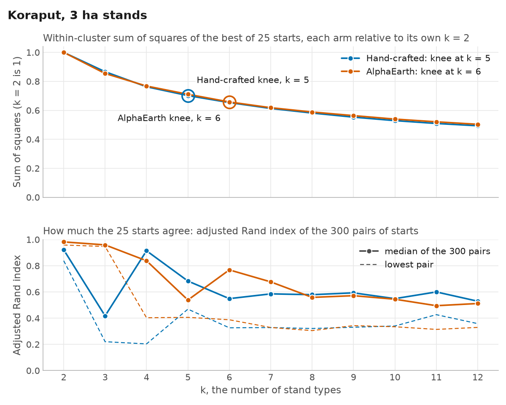
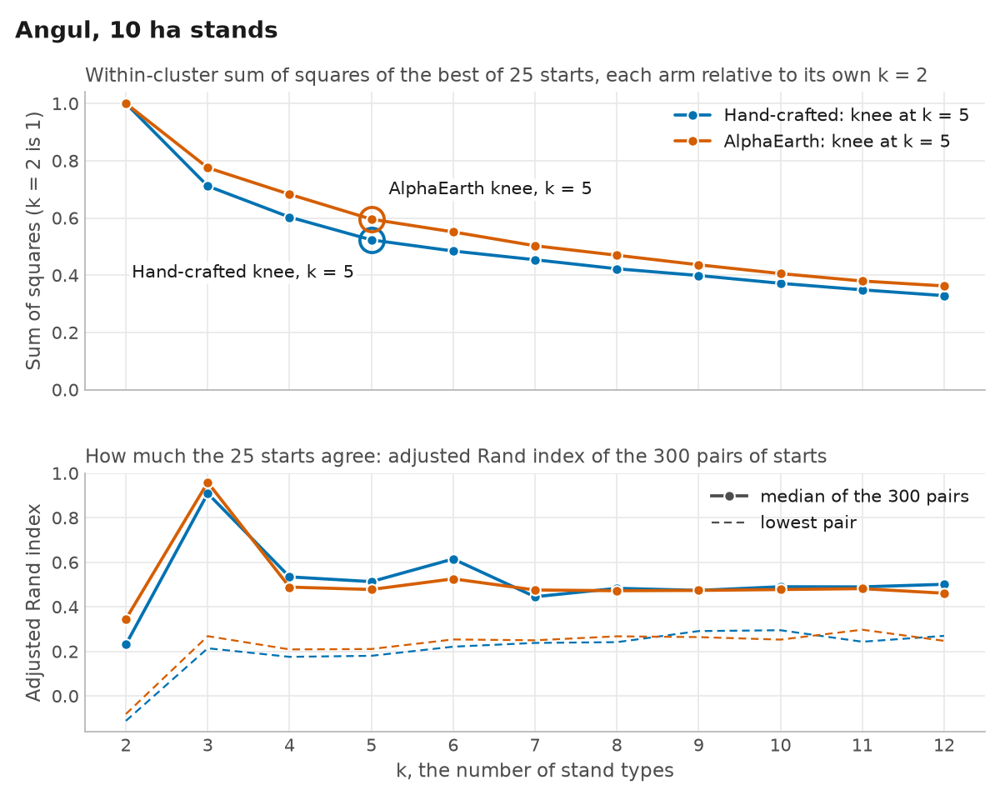
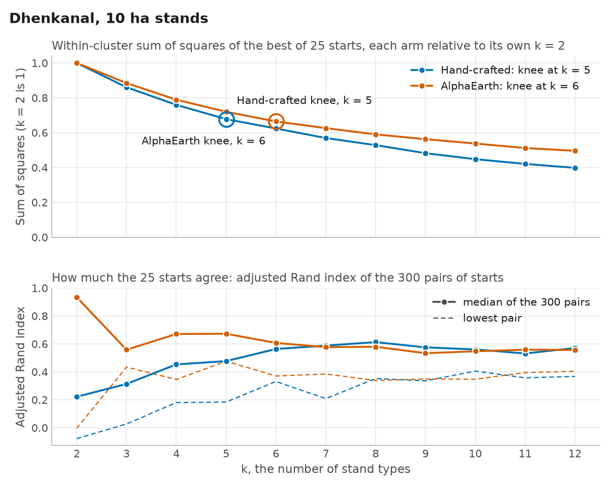
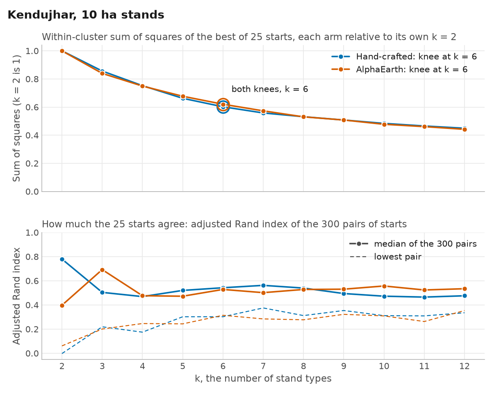
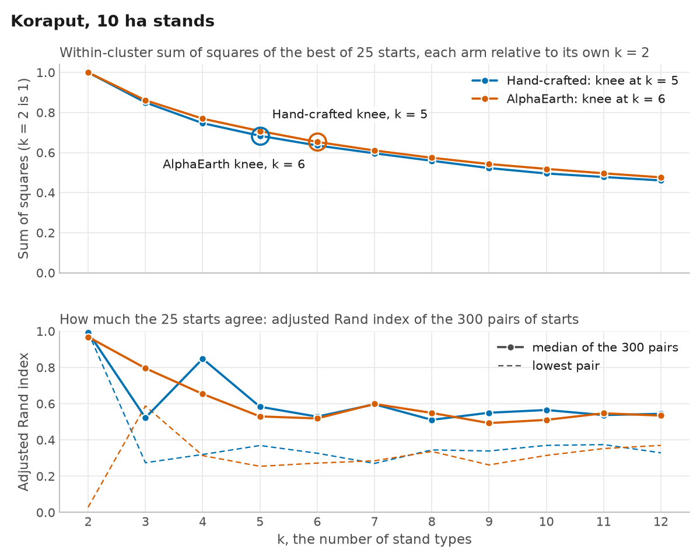
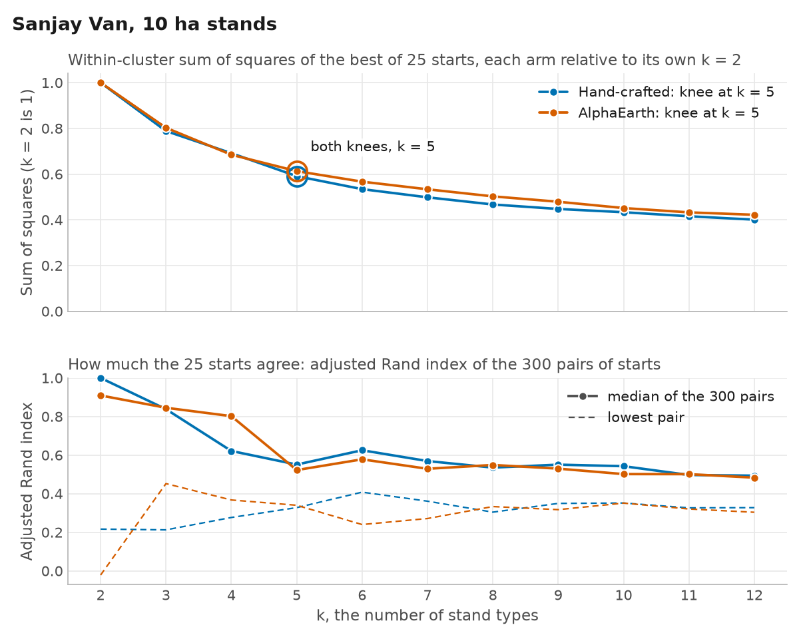
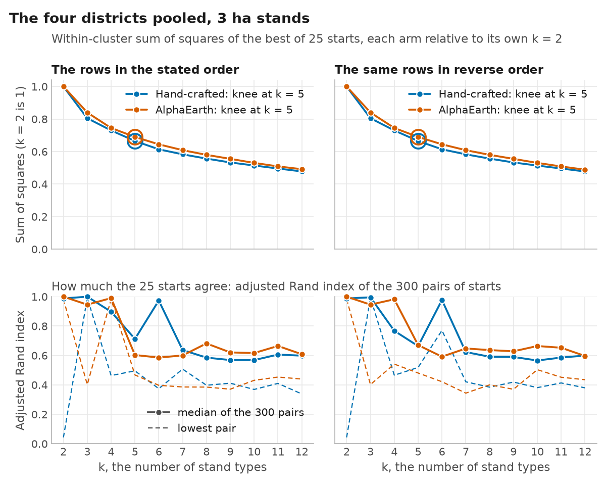
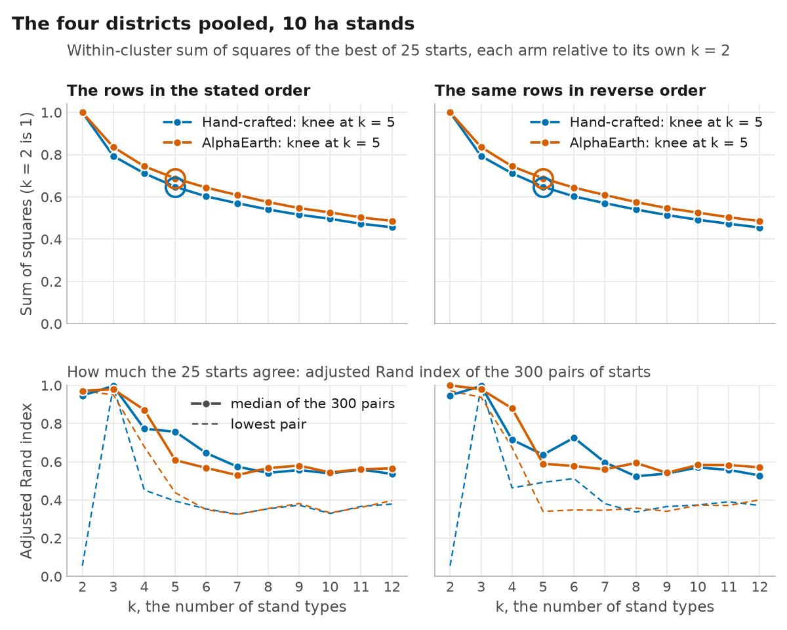

# The elbow report of R3's first half (round 14, Task 6)

For Jaskaran to choose k from. For R3, k for each area is his choice, from this report alone, before any R3 field score exists (`odisha_script/PHASE_KEPTLAND_PREDECLARED.md`, the change of 26 Oct 2026; register entry `field-r3-k-chosen-by-jaskaran-from-the-elbow-report`). The report reads no plot and computes no field score, and it recommends no k.

Written by `odisha_script/r14_elbow_report.py` from the records of R3's first half, the runs through the k elbow (`/Users/karan/Desktop/phd-code/docs/reproducibility/r14_runs/first_half`). The numbers behind the figures are in `r14_elbow_part2.csv`, one figure per area is in `r14_elbow_part2/`, and the record of the run that wrote them (the command, when it ran, the git commit, and every input with its SHA-256) is `r14_elbow_part2_run.json`. The areas are each Odisha district at 3 ha and at 10 ha, Sanjay Van (10 ha stands) and the 10 km tile in Angul (3 ha stands), each with its two arms, hand-crafted and AlphaEarth, side by side, and the four districts pooled, for each arm and stand size, in the stated order and with the same rows in reverse order. The tile has one arm, hand-crafted: R3 has no AlphaEarth run of the tile.

Each run's elbow is the run's own (its `_k_elbow.csv`). Each was also made again here from the run's table of stands and preprocessing record, by the code that makes the pooled elbows, and is the run's own in every number (18 of 18 runs with a record), its preprocessing its record.

**No record of 1 of the 19 runs:** `odisha_v120_3ha_tile10km_angul_keptland_s1desc_r14`. Their areas show the other arm only, and a pool that needs one is not computed.

## How the numbers are made

Each run's elbow is the k elbow step's (`k_elbow.in_fit_space` on; `fmu.stages.k_elbow`). It takes the run's table of stands (one row per stand, its mean in every candidate band) and preprocesses it over every stand by the runs' rule (`clustering.log_rule` right_skew: a band whose IQR is at most 1e-9 is dropped, and an angle's sine and cosine only together, when their shared spread is; only a band skewed to the right, skew above 1.0, is logged, as log1p((x - min) / IQR), and it is then dropped if its IQR after the log is at most 1e-9; the sine and cosine of an angle are never logged; each other band is centred by its median and divided by its IQR (a logged band's after the log), and the sine and cosine of an angle by their medians and by their shared spread, the root mean square of their two IQRs; exact quartiles). It then fits k-means on the fit's own rows in that space (the stands below the merge's minimum area, 1 ha in every R3 config, left out), for each k from 2 to 12: 25 k-means++ starts from seed 42, each refined by Lloyd's algorithm (scikit-learn, one thread), the start with the lowest within-cluster sum of squares kept. That sum, rounded to 6 decimals (as the csv gives it; the tables below, to 2), is the curve, and the knee is the k farthest from the chord between the curve's first and last points (`fmu.stages.k_elbow.knee`). At each k the adjusted Rand index of every pair of the 25 starts (300 pairs) says how much the starts agree with each other: a diagnostic of the clustering, not a field score. Its median and lowest are given, rounded to 6 decimals in the csv and to 4 in the tables, where 1 is given as 1, and an index between -0.00005 and 0.00005 other than 0 with two significant figures, so that its sign shows. The pooled elbow of an arm and stand size puts the four districts' tables of stands together, each row keyed by its district and stand label (labels repeat across districts), in the order Angul, Dhenkanal, Kendujhar, Koraput and within each by stand label, each row keeping whether it is in its run's fit. It preprocesses them together by the runs' own rule, threshold and angle pairs, and sweeps k on the rows in the fit with the same code and the same starts (`fmu.stages.k_elbow.fit_space_sweep`). k-means++ depends on the order of the rows, so each pooled elbow is also made with the same rows in reverse order, with the same preprocessing and the same sweep, and given beside it (the declaration's note of 27 Oct 2026); each run's elbow has one order, the run's. The two arms' sums of squares are in different spaces (different bands), so the figures show each relative to its own value at k = 2, and the tables give them as they are.

## The knees

| Area | Hand-crafted knee | AlphaEarth knee | Stands in the fit, of those in the table |
|---|---:|---:|---|
| Angul, 3 ha stands | 4 | 5 | Hand-crafted 166 of 220; AlphaEarth 181 of 234 |
| Dhenkanal, 3 ha stands | 6 | 5 | Hand-crafted 397 of 544; AlphaEarth 424 of 570 |
| Kendujhar, 3 ha stands | 6 | 6 | Hand-crafted 396 of 539; AlphaEarth 409 of 554 |
| Koraput, 3 ha stands | 5 | 6 | Hand-crafted 1,307 of 1,616; AlphaEarth 1,333 of 1,639 |
| Angul, 10 ha stands | 5 | 5 | Hand-crafted 75 of 127; AlphaEarth 74 of 127 |
| Dhenkanal, 10 ha stands | 5 | 6 | Hand-crafted 180 of 327; AlphaEarth 182 of 328 |
| Kendujhar, 10 ha stands | 6 | 6 | Hand-crafted 206 of 350; AlphaEarth 207 of 350 |
| Koraput, 10 ha stands | 5 | 6 | Hand-crafted 666 of 968; AlphaEarth 637 of 938 |
| Sanjay Van, 10 ha stands | 5 | 5 | Hand-crafted 189 of 490; AlphaEarth 174 of 560 |
| The 10 km tile in Angul, 3 ha stands (one arm, hand-crafted) | no record | no run (one arm) | none |
| The four districts pooled, 3 ha stands | 5 | 5 | Hand-crafted 2,266 of 2,919; AlphaEarth 2,347 of 2,997 |
| The four districts pooled, 3 ha stands, the same rows in reverse order | 5 | 5 | Hand-crafted 2,266 of 2,919; AlphaEarth 2,347 of 2,997 |
| The four districts pooled, 10 ha stands | 5 | 5 | Hand-crafted 1,127 of 1,772; AlphaEarth 1,100 of 1,743 |
| The four districts pooled, 10 ha stands, the same rows in reverse order | 5 | 5 | Hand-crafted 1,127 of 1,772; AlphaEarth 1,100 of 1,743 |

## Angul, 3 ha stands

Hand-crafted: `odisha_v120_3ha_squares_angul_keptland_s1desc_r14`, 166 stands in the fit of 220 in its table of stands. AlphaEarth: `odisha_alphaearth_3ha_squares_angul_keptland_r14`, 181 stands in the fit of 234 in its table of stands.

*Top: each arm's within-cluster sum of squares (the best of the starts) divided by its own value at k = 2, as the two arms' sums are in different spaces, on a scale from 0; each arm's knee is ringed and labelled. Bottom: the adjusted Rand index of the 300 pairs of the 25 starts, the median (solid, with points) and the lowest (dashed), on a scale from 0 to 1 taken down to -0.1580, below the lowest, -0.1080, where an index below 0 means two starts agree less than chance would. Blue: hand-crafted; vermillion: AlphaEarth.*

| k | Hand-crafted: sum of squares | median ARI | lowest ARI | AlphaEarth: sum of squares | median ARI | lowest ARI |
|---:|---:|---:|---:|---:|---:|---:|
| 2 | 1,496.23 | 0.7700 | -0.1080 | 4,790.93 | 0.1967 | -0.0711 |
| 3 | 1,109.47 | 0.8462 | 0.6730 | 3,784.18 | 0.9384 | 0.8454 |
| 4 | 929.14 (knee) | 0.8830 | 0.2700 | 3,357.37 | 0.5288 | 0.2760 |
| 5 | 838.52 | 0.5337 | 0.3786 | 3,003.47 (knee) | 0.5200 | 0.2906 |
| 6 | 778.21 | 0.4955 | 0.2694 | 2,729.05 | 0.5382 | 0.2956 |
| 7 | 728.90 | 0.4736 | 0.2814 | 2,552.04 | 0.5670 | 0.3339 |
| 8 | 682.84 | 0.4368 | 0.2995 | 2,398.00 | 0.5600 | 0.3182 |
| 9 | 655.02 | 0.4351 | 0.2605 | 2,280.06 | 0.5184 | 0.2785 |
| 10 | 620.94 | 0.4370 | 0.2705 | 2,146.83 | 0.5312 | 0.3539 |
| 11 | 595.28 | 0.4358 | 0.2912 | 2,065.34 | 0.5208 | 0.3419 |
| 12 | 573.41 | 0.4457 | 0.2716 | 1,977.65 | 0.4767 | 0.2711 |

## Dhenkanal, 3 ha stands

Hand-crafted: `odisha_v120_3ha_squares_dhenkanal_keptland_s1desc_r14`, 397 stands in the fit of 544 in its table of stands. AlphaEarth: `odisha_alphaearth_3ha_squares_dhenkanal_keptland_r14`, 424 stands in the fit of 570 in its table of stands.

*Top: each arm's within-cluster sum of squares (the best of the starts) divided by its own value at k = 2, as the two arms' sums are in different spaces, on a scale from 0; each arm's knee is ringed and labelled. Bottom: the adjusted Rand index of the 300 pairs of the 25 starts, the median (solid, with points) and the lowest (dashed), on a scale from 0 to 1 taken down to -0.0651, below the lowest, -0.0151, where an index below 0 means two starts agree less than chance would. Blue: hand-crafted; vermillion: AlphaEarth.*

| k | Hand-crafted: sum of squares | median ARI | lowest ARI | AlphaEarth: sum of squares | median ARI | lowest ARI |
|---:|---:|---:|---:|---:|---:|---:|
| 2 | 3,105.93 | 0.8539 | -0.0151 | 8,628.44 | 0.9906 | 0.9441 |
| 3 | 2,540.54 | 0.4907 | 0.0002 | 7,576.07 | 0.8389 | 0.6487 |
| 4 | 2,289.99 | 0.5552 | 0.3079 | 6,844.37 | 0.6280 | 0.3681 |
| 5 | 2,063.59 | 0.6289 | 0.3334 | 6,363.77 (knee) | 0.6850 | 0.3561 |
| 6 | 1,883.18 (knee) | 0.6780 | 0.2761 | 6,008.16 | 0.6190 | 0.3580 |
| 7 | 1,750.54 | 0.5970 | 0.3124 | 5,684.40 | 0.6152 | 0.4266 |
| 8 | 1,642.68 | 0.5968 | 0.3864 | 5,425.38 | 0.5358 | 0.3538 |
| 9 | 1,559.92 | 0.5629 | 0.3173 | 5,142.30 | 0.5770 | 0.3839 |
| 10 | 1,487.36 | 0.5831 | 0.4068 | 4,931.58 | 0.5576 | 0.3541 |
| 11 | 1,422.90 | 0.6578 | 0.4297 | 4,725.49 | 0.6228 | 0.4342 |
| 12 | 1,352.96 | 0.6657 | 0.3875 | 4,544.47 | 0.5763 | 0.4053 |

## Kendujhar, 3 ha stands

Hand-crafted: `odisha_v120_3ha_squares_kendujhar_keptland_s1desc_r14`, 396 stands in the fit of 539 in its table of stands. AlphaEarth: `odisha_alphaearth_3ha_squares_kendujhar_keptland_r14`, 409 stands in the fit of 554 in its table of stands.

*Top: each arm's within-cluster sum of squares (the best of the starts) divided by its own value at k = 2, as the two arms' sums are in different spaces, on a scale from 0; each arm's knee is ringed and labelled. Bottom: the adjusted Rand index of the 300 pairs of the 25 starts, the median (solid, with points) and the lowest (dashed), on a scale from 0 to 1 taken down to -0.0518, below the lowest, -0.0018, where an index below 0 means two starts agree less than chance would. Blue: hand-crafted; vermillion: AlphaEarth.*

| k | Hand-crafted: sum of squares | median ARI | lowest ARI | AlphaEarth: sum of squares | median ARI | lowest ARI |
|---:|---:|---:|---:|---:|---:|---:|
| 2 | 2,978.51 | 0.9400 | -0.0018 | 9,708.05 | 0.7274 | 0.0636 |
| 3 | 2,477.36 | 0.8118 | 0.6438 | 8,209.34 | 0.9096 | 0.1993 |
| 4 | 2,201.19 | 0.5564 | 0.3217 | 7,407.03 | 0.4799 | 0.2032 |
| 5 | 1,985.19 | 0.5887 | 0.3572 | 6,761.97 | 0.4680 | 0.2446 |
| 6 | 1,807.81 (knee) | 0.7695 | 0.3587 | 6,215.49 (knee) | 0.4853 | 0.2816 |
| 7 | 1,693.95 | 0.6332 | 0.4466 | 5,717.66 | 0.5381 | 0.3266 |
| 8 | 1,604.00 | 0.6134 | 0.4376 | 5,355.19 | 0.5721 | 0.3129 |
| 9 | 1,531.64 | 0.6373 | 0.4211 | 5,032.87 | 0.6944 | 0.4454 |
| 10 | 1,472.85 | 0.5917 | 0.3927 | 4,831.88 | 0.6277 | 0.4403 |
| 11 | 1,420.57 | 0.5914 | 0.4243 | 4,606.00 | 0.6591 | 0.3940 |
| 12 | 1,373.08 | 0.5434 | 0.3751 | 4,430.57 | 0.6278 | 0.3539 |

## Koraput, 3 ha stands

Hand-crafted: `odisha_v120_3ha_squares_koraput_keptland_s1desc_r14`, 1,307 stands in the fit of 1,616 in its table of stands. AlphaEarth: `odisha_alphaearth_3ha_squares_koraput_keptland_r14`, 1,333 stands in the fit of 1,639 in its table of stands.

*Top: each arm's within-cluster sum of squares (the best of the starts) divided by its own value at k = 2, as the two arms' sums are in different spaces, on a scale from 0; each arm's knee is ringed and labelled. Bottom: the adjusted Rand index of the 300 pairs of the 25 starts, the median (solid, with points) and the lowest (dashed), on a scale from 0 to 1. Blue: hand-crafted; vermillion: AlphaEarth.*

| k | Hand-crafted: sum of squares | median ARI | lowest ARI | AlphaEarth: sum of squares | median ARI | lowest ARI |
|---:|---:|---:|---:|---:|---:|---:|
| 2 | 12,030.57 | 0.9217 | 0.8383 | 34,167.22 | 0.9820 | 0.9582 |
| 3 | 10,424.96 | 0.4175 | 0.2205 | 29,188.02 | 0.9590 | 0.9469 |
| 4 | 9,175.51 | 0.9143 | 0.2035 | 26,228.62 | 0.8381 | 0.4031 |
| 5 | 8,441.48 (knee) | 0.6832 | 0.4688 | 24,289.51 | 0.5384 | 0.4061 |
| 6 | 7,863.00 | 0.5490 | 0.3264 | 22,474.09 (knee) | 0.7684 | 0.3878 |
| 7 | 7,374.93 | 0.5853 | 0.3282 | 21,121.25 | 0.6769 | 0.3286 |
| 8 | 6,994.09 | 0.5792 | 0.3211 | 20,103.60 | 0.5586 | 0.3052 |
| 9 | 6,652.19 | 0.5931 | 0.3307 | 19,253.02 | 0.5716 | 0.3429 |
| 10 | 6,363.89 | 0.5490 | 0.3402 | 18,429.95 | 0.5446 | 0.3344 |
| 11 | 6,127.70 | 0.6001 | 0.4267 | 17,791.57 | 0.4951 | 0.3142 |
| 12 | 5,936.88 | 0.5294 | 0.3583 | 17,207.19 | 0.5118 | 0.3295 |

## Angul, 10 ha stands

Hand-crafted: `odisha_v120_10ha_squares_angul_keptland_s1desc_r14`, 75 stands in the fit of 127 in its table of stands. AlphaEarth: `odisha_alphaearth_10ha_squares_angul_keptland_r14`, 74 stands in the fit of 127 in its table of stands.

*Top: each arm's within-cluster sum of squares (the best of the starts) divided by its own value at k = 2, as the two arms' sums are in different spaces, on a scale from 0; each arm's knee is ringed and labelled. Bottom: the adjusted Rand index of the 300 pairs of the 25 starts, the median (solid, with points) and the lowest (dashed), on a scale from 0 to 1 taken down to -0.1619, below the lowest, -0.1119, where an index below 0 means two starts agree less than chance would. Blue: hand-crafted; vermillion: AlphaEarth.*

| k | Hand-crafted: sum of squares | median ARI | lowest ARI | AlphaEarth: sum of squares | median ARI | lowest ARI |
|---:|---:|---:|---:|---:|---:|---:|
| 2 | 562.42 | 0.2312 | -0.1119 | 1,860.75 | 0.3453 | -0.0811 |
| 3 | 400.08 | 0.9090 | 0.2140 | 1,442.84 | 0.9585 | 0.2684 |
| 4 | 339.08 | 0.5345 | 0.1755 | 1,270.18 | 0.4885 | 0.2089 |
| 5 | 294.28 (knee) | 0.5131 | 0.1802 | 1,108.25 (knee) | 0.4778 | 0.2107 |
| 6 | 272.45 | 0.6148 | 0.2211 | 1,025.68 | 0.5256 | 0.2536 |
| 7 | 255.30 | 0.4453 | 0.2380 | 935.57 | 0.4756 | 0.2497 |
| 8 | 237.57 | 0.4831 | 0.2414 | 873.99 | 0.4723 | 0.2677 |
| 9 | 224.32 | 0.4737 | 0.2911 | 811.80 | 0.4737 | 0.2641 |
| 10 | 208.99 | 0.4901 | 0.2950 | 754.80 | 0.4777 | 0.2528 |
| 11 | 196.18 | 0.4895 | 0.2434 | 706.40 | 0.4816 | 0.2973 |
| 12 | 184.79 | 0.5011 | 0.2697 | 674.42 | 0.4610 | 0.2474 |

## Dhenkanal, 10 ha stands

Hand-crafted: `odisha_v120_10ha_squares_dhenkanal_keptland_s1desc_r14`, 180 stands in the fit of 327 in its table of stands. AlphaEarth: `odisha_alphaearth_10ha_squares_dhenkanal_keptland_r14`, 182 stands in the fit of 328 in its table of stands.

*Top: each arm's within-cluster sum of squares (the best of the starts) divided by its own value at k = 2, as the two arms' sums are in different spaces, on a scale from 0; each arm's knee is ringed and labelled. Bottom: the adjusted Rand index of the 300 pairs of the 25 starts, the median (solid, with points) and the lowest (dashed), on a scale from 0 to 1 taken down to -0.1277, below the lowest, -0.0777, where an index below 0 means two starts agree less than chance would. Blue: hand-crafted; vermillion: AlphaEarth.*

| k | Hand-crafted: sum of squares | median ARI | lowest ARI | AlphaEarth: sum of squares | median ARI | lowest ARI |
|---:|---:|---:|---:|---:|---:|---:|
| 2 | 1,056.23 | 0.2219 | -0.0777 | 3,356.10 | 0.9346 | -0.0044 |
| 3 | 909.27 | 0.3136 | 0.0272 | 2,969.01 | 0.5585 | 0.4339 |
| 4 | 802.51 | 0.4532 | 0.1802 | 2,648.53 | 0.6711 | 0.3458 |
| 5 | 715.65 (knee) | 0.4771 | 0.1843 | 2,416.30 | 0.6727 | 0.4765 |
| 6 | 659.03 | 0.5637 | 0.3313 | 2,229.35 (knee) | 0.6070 | 0.3704 |
| 7 | 601.30 | 0.5880 | 0.2086 | 2,100.92 | 0.5770 | 0.3848 |
| 8 | 558.16 | 0.6128 | 0.3524 | 1,980.74 | 0.5798 | 0.3386 |
| 9 | 509.32 | 0.5754 | 0.3357 | 1,888.24 | 0.5336 | 0.3492 |
| 10 | 473.14 | 0.5605 | 0.4057 | 1,804.62 | 0.5473 | 0.3474 |
| 11 | 444.30 | 0.5316 | 0.3576 | 1,717.80 | 0.5588 | 0.3949 |
| 12 | 420.46 | 0.5707 | 0.3674 | 1,664.06 | 0.5564 | 0.4036 |

## Kendujhar, 10 ha stands

Hand-crafted: `odisha_v120_10ha_squares_kendujhar_keptland_s1desc_r14`, 206 stands in the fit of 350 in its table of stands. AlphaEarth: `odisha_alphaearth_10ha_squares_kendujhar_keptland_r14`, 207 stands in the fit of 350 in its table of stands.

*Top: each arm's within-cluster sum of squares (the best of the starts) divided by its own value at k = 2, as the two arms' sums are in different spaces, on a scale from 0; each arm's knee is ringed and labelled. Bottom: the adjusted Rand index of the 300 pairs of the 25 starts, the median (solid, with points) and the lowest (dashed), on a scale from 0 to 1 taken down to -0.0524, below the lowest, -0.0024, where an index below 0 means two starts agree less than chance would. Blue: hand-crafted; vermillion: AlphaEarth.*

| k | Hand-crafted: sum of squares | median ARI | lowest ARI | AlphaEarth: sum of squares | median ARI | lowest ARI |
|---:|---:|---:|---:|---:|---:|---:|
| 2 | 1,552.86 | 0.7795 | -0.0024 | 4,642.71 | 0.3974 | 0.0610 |
| 3 | 1,329.66 | 0.5039 | 0.2190 | 3,897.47 | 0.6924 | 0.2007 |
| 4 | 1,168.17 | 0.4691 | 0.1747 | 3,478.78 | 0.4763 | 0.2461 |
| 5 | 1,028.52 | 0.5202 | 0.3021 | 3,142.83 | 0.4721 | 0.2433 |
| 6 | 934.86 (knee) | 0.5423 | 0.3023 | 2,879.17 (knee) | 0.5282 | 0.3143 |
| 7 | 866.61 | 0.5620 | 0.3751 | 2,660.77 | 0.5016 | 0.2843 |
| 8 | 825.25 | 0.5396 | 0.3119 | 2,462.92 | 0.5280 | 0.2770 |
| 9 | 788.65 | 0.4944 | 0.3537 | 2,357.87 | 0.5303 | 0.3221 |
| 10 | 751.36 | 0.4723 | 0.3113 | 2,217.03 | 0.5568 | 0.3091 |
| 11 | 722.81 | 0.4649 | 0.3093 | 2,139.72 | 0.5238 | 0.2627 |
| 12 | 697.86 | 0.4758 | 0.3353 | 2,051.07 | 0.5342 | 0.3532 |

## Koraput, 10 ha stands

Hand-crafted: `odisha_v120_10ha_squares_koraput_keptland_s1desc_r14`, 666 stands in the fit of 968 in its table of stands. AlphaEarth: `odisha_alphaearth_10ha_squares_koraput_keptland_r14`, 637 stands in the fit of 938 in its table of stands.

*Top: each arm's within-cluster sum of squares (the best of the starts) divided by its own value at k = 2, as the two arms' sums are in different spaces, on a scale from 0; each arm's knee is ringed and labelled. Bottom: the adjusted Rand index of the 300 pairs of the 25 starts, the median (solid, with points) and the lowest (dashed), on a scale from 0 to 1. Blue: hand-crafted; vermillion: AlphaEarth.*

| k | Hand-crafted: sum of squares | median ARI | lowest ARI | AlphaEarth: sum of squares | median ARI | lowest ARI |
|---:|---:|---:|---:|---:|---:|---:|
| 2 | 5,883.62 | 0.9939 | 0.9939 | 16,303.58 | 0.9687 | 0.0285 |
| 3 | 5,001.62 | 0.5223 | 0.2742 | 14,037.04 | 0.7957 | 0.5875 |
| 4 | 4,392.18 | 0.8480 | 0.3197 | 12,539.22 | 0.6537 | 0.3137 |
| 5 | 4,022.80 (knee) | 0.5830 | 0.3692 | 11,531.24 | 0.5297 | 0.2543 |
| 6 | 3,738.33 | 0.5284 | 0.3266 | 10,646.48 (knee) | 0.5186 | 0.2721 |
| 7 | 3,508.31 | 0.5966 | 0.2703 | 9,950.11 | 0.5986 | 0.2848 |
| 8 | 3,289.30 | 0.5108 | 0.3449 | 9,356.98 | 0.5490 | 0.3363 |
| 9 | 3,074.01 | 0.5501 | 0.3390 | 8,847.95 | 0.4928 | 0.2621 |
| 10 | 2,915.82 | 0.5651 | 0.3698 | 8,453.85 | 0.5107 | 0.3144 |
| 11 | 2,812.84 | 0.5372 | 0.3742 | 8,094.44 | 0.5470 | 0.3524 |
| 12 | 2,711.06 | 0.5440 | 0.3290 | 7,764.36 | 0.5342 | 0.3698 |

## Sanjay Van, 10 ha stands

Hand-crafted: `sanjay_van_baseline_keptland_r14`, 189 stands in the fit of 490 in its table of stands. AlphaEarth: `sanjay_van_alphaearth_keptland_r14`, 174 stands in the fit of 560 in its table of stands.

*Top: each arm's within-cluster sum of squares (the best of the starts) divided by its own value at k = 2, as the two arms' sums are in different spaces, on a scale from 0; each arm's knee is ringed and labelled. Bottom: the adjusted Rand index of the 300 pairs of the 25 starts, the median (solid, with points) and the lowest (dashed), on a scale from 0 to 1 taken down to -0.0716, below the lowest, -0.0216, where an index below 0 means two starts agree less than chance would. Blue: hand-crafted; vermillion: AlphaEarth.*

| k | Hand-crafted: sum of squares | median ARI | lowest ARI | AlphaEarth: sum of squares | median ARI | lowest ARI |
|---:|---:|---:|---:|---:|---:|---:|
| 2 | 1,268.17 | 1 | 0.2165 | 2,478.46 | 0.9091 | -0.0216 |
| 3 | 999.72 | 0.8382 | 0.2126 | 1,989.14 | 0.8454 | 0.4522 |
| 4 | 876.70 | 0.6214 | 0.2767 | 1,696.72 | 0.8019 | 0.3674 |
| 5 | 749.31 (knee) | 0.5509 | 0.3278 | 1,519.06 (knee) | 0.5224 | 0.3401 |
| 6 | 677.42 | 0.6252 | 0.4080 | 1,404.88 | 0.5781 | 0.2401 |
| 7 | 632.02 | 0.5692 | 0.3612 | 1,322.19 | 0.5291 | 0.2713 |
| 8 | 592.17 | 0.5353 | 0.3043 | 1,245.43 | 0.5490 | 0.3334 |
| 9 | 567.41 | 0.5506 | 0.3496 | 1,187.17 | 0.5299 | 0.3173 |
| 10 | 549.30 | 0.5426 | 0.3517 | 1,118.74 | 0.5015 | 0.3512 |
| 11 | 526.94 | 0.4969 | 0.3267 | 1,071.92 | 0.5012 | 0.3207 |
| 12 | 508.01 | 0.4936 | 0.3276 | 1,045.79 | 0.4831 | 0.3037 |

## The 10 km tile in Angul, 3 ha stands (one arm, hand-crafted)

Hand-crafted: `odisha_v120_3ha_tile10km_angul_keptland_s1desc_r14`, no record. The tile has one arm: R3 has no AlphaEarth run of the tile.

No figure and no table: no arm of this area has an elbow.

## The four districts pooled, 3 ha stands

The four districts' tables of stands put together, each row keyed by its district and stand label: the stands of each table, and in brackets those in the fit.

| District | Hand-crafted: stands (in the fit) | AlphaEarth: stands (in the fit) |
|---|---:|---:|
| Angul | 220 (166) | 234 (181) |
| Dhenkanal | 544 (397) | 570 (424) |
| Kendujhar | 539 (396) | 554 (409) |
| Koraput | 1,616 (1,307) | 1,639 (1,333) |
| Pooled | 2,919 (2,266) | 2,997 (2,347) |

Hand-crafted: preprocessed together by the runs' rule (`right_skew`, skew threshold 1.0; the angles taken as sine and cosine: `ndvi_phase_annual`, `aspect`): 22 of 22 candidate bands kept, 4 logged (`vv_iqr`, `vh_iqr`, `vv_minus_vh_median`, `canopy_height_std`), dropped as constant: none.

AlphaEarth: preprocessed together by the runs' rule (`right_skew`, skew threshold 1.0; the angles taken as sine and cosine: none): 64 of 64 candidate bands kept, 0 logged, dropped as constant: none.

*Left: the rows in the stated order; right: the same rows in reverse order, on the same axes. Top: each arm's within-cluster sum of squares (the best of the starts) divided by its own value at k = 2 in that order, as the two arms' sums are in different spaces, on a scale from 0; each arm's knee is ringed and named in each panel's legend. Bottom: the adjusted Rand index of the 300 pairs of the 25 starts, the median (solid, with points) and the lowest (dashed), on a scale from 0 to 1. Blue: hand-crafted; vermillion: AlphaEarth.*

**The rows in the stated order** (Angul, Dhenkanal, Kendujhar, Koraput, each by stand label). Knees: hand-crafted k = 5, AlphaEarth k = 5.

| k | Hand-crafted: sum of squares | median ARI | lowest ARI | AlphaEarth: sum of squares | median ARI | lowest ARI |
|---:|---:|---:|---:|---:|---:|---:|
| 2 | 21,236.25 | 0.9876 | 0.0434 | 56,081.02 | 1 | 0.9829 |
| 3 | 17,099.56 | 1 | 0.9924 | 47,120.33 | 0.9457 | 0.4021 |
| 4 | 15,506.07 | 0.8977 | 0.4638 | 41,783.52 | 0.9903 | 0.9822 |
| 5 | 14,126.58 (knee) | 0.7126 | 0.4957 | 38,703.60 (knee) | 0.6034 | 0.4678 |
| 6 | 13,042.31 | 0.9737 | 0.3746 | 36,156.61 | 0.5860 | 0.3975 |
| 7 | 12,385.66 | 0.6372 | 0.5075 | 34,143.77 | 0.6003 | 0.3861 |
| 8 | 11,831.10 | 0.5857 | 0.3978 | 32,534.49 | 0.6820 | 0.3854 |
| 9 | 11,324.54 | 0.5690 | 0.4119 | 31,150.47 | 0.6210 | 0.3711 |
| 10 | 10,928.13 | 0.5688 | 0.3693 | 29,753.87 | 0.6166 | 0.4313 |
| 11 | 10,535.51 | 0.6064 | 0.4105 | 28,548.84 | 0.6650 | 0.4536 |
| 12 | 10,154.11 | 0.5988 | 0.3386 | 27,585.16 | 0.6084 | 0.4399 |

**The same rows in reverse order** (the same preprocessing and the same sweep). Knees: hand-crafted k = 5, AlphaEarth k = 5.

| k | Hand-crafted: sum of squares | median ARI | lowest ARI | AlphaEarth: sum of squares | median ARI | lowest ARI |
|---:|---:|---:|---:|---:|---:|---:|
| 2 | 21,236.25 | 0.9876 | 0.0434 | 56,081.02 | 1 | 0.9829 |
| 3 | 17,099.56 | 0.9954 | 0.9924 | 47,120.65 | 0.9458 | 0.4026 |
| 4 | 15,506.24 | 0.7678 | 0.4659 | 41,783.52 | 0.9822 | 0.5416 |
| 5 | 14,126.38 (knee) | 0.6641 | 0.5189 | 38,703.60 (knee) | 0.6707 | 0.4809 |
| 6 | 13,042.33 | 0.9772 | 0.7706 | 36,155.79 | 0.5922 | 0.4218 |
| 7 | 12,385.53 | 0.6234 | 0.4213 | 34,137.99 | 0.6477 | 0.3442 |
| 8 | 11,827.53 | 0.5916 | 0.3849 | 32,532.02 | 0.6369 | 0.4005 |
| 9 | 11,324.61 | 0.5903 | 0.4193 | 31,152.08 | 0.6285 | 0.3705 |
| 10 | 10,919.69 | 0.5660 | 0.3816 | 29,759.75 | 0.6645 | 0.5036 |
| 11 | 10,538.28 | 0.5861 | 0.4135 | 28,525.08 | 0.6527 | 0.4521 |
| 12 | 10,148.14 | 0.5994 | 0.3802 | 27,416.46 | 0.5970 | 0.4354 |

## The four districts pooled, 10 ha stands

The four districts' tables of stands put together, each row keyed by its district and stand label: the stands of each table, and in brackets those in the fit.

| District | Hand-crafted: stands (in the fit) | AlphaEarth: stands (in the fit) |
|---|---:|---:|
| Angul | 127 (75) | 127 (74) |
| Dhenkanal | 327 (180) | 328 (182) |
| Kendujhar | 350 (206) | 350 (207) |
| Koraput | 968 (666) | 938 (637) |
| Pooled | 1,772 (1,127) | 1,743 (1,100) |

Hand-crafted: preprocessed together by the runs' rule (`right_skew`, skew threshold 1.0; the angles taken as sine and cosine: `ndvi_phase_annual`, `aspect`): 22 of 22 candidate bands kept, 4 logged (`vv_iqr`, `vh_iqr`, `vv_minus_vh_median`, `canopy_height_std`), dropped as constant: none.

AlphaEarth: preprocessed together by the runs' rule (`right_skew`, skew threshold 1.0; the angles taken as sine and cosine: none): 64 of 64 candidate bands kept, 0 logged, dropped as constant: none.

*Left: the rows in the stated order; right: the same rows in reverse order, on the same axes. Top: each arm's within-cluster sum of squares (the best of the starts) divided by its own value at k = 2 in that order, as the two arms' sums are in different spaces, on a scale from 0; each arm's knee is ringed and named in each panel's legend. Bottom: the adjusted Rand index of the 300 pairs of the 25 starts, the median (solid, with points) and the lowest (dashed), on a scale from 0 to 1. Blue: hand-crafted; vermillion: AlphaEarth.*

**The rows in the stated order** (Angul, Dhenkanal, Kendujhar, Koraput, each by stand label). Knees: hand-crafted k = 5, AlphaEarth k = 5.

| k | Hand-crafted: sum of squares | median ARI | lowest ARI | AlphaEarth: sum of squares | median ARI | lowest ARI |
|---:|---:|---:|---:|---:|---:|---:|
| 2 | 10,596.42 | 0.9473 | 0.0559 | 26,704.89 | 0.9710 | 0.9710 |
| 3 | 8,409.09 | 0.9969 | 0.9939 | 22,321.01 | 0.9796 | 0.9506 |
| 4 | 7,541.37 | 0.7726 | 0.4521 | 19,890.93 | 0.8716 | 0.6787 |
| 5 | 6,864.66 (knee) | 0.7576 | 0.3945 | 18,366.93 (knee) | 0.6086 | 0.4384 |
| 6 | 6,384.68 | 0.6457 | 0.3534 | 17,200.17 | 0.5678 | 0.3496 |
| 7 | 6,044.65 | 0.5747 | 0.3262 | 16,263.83 | 0.5304 | 0.3240 |
| 8 | 5,728.38 | 0.5417 | 0.3540 | 15,381.85 | 0.5673 | 0.3553 |
| 9 | 5,466.73 | 0.5568 | 0.3730 | 14,612.65 | 0.5799 | 0.3816 |
| 10 | 5,259.39 | 0.5394 | 0.3296 | 14,064.38 | 0.5444 | 0.3329 |
| 11 | 5,013.96 | 0.5595 | 0.3667 | 13,435.87 | 0.5609 | 0.3614 |
| 12 | 4,836.99 | 0.5365 | 0.3786 | 12,992.83 | 0.5656 | 0.3969 |

**The same rows in reverse order** (the same preprocessing and the same sweep). Knees: hand-crafted k = 5, AlphaEarth k = 5.

| k | Hand-crafted: sum of squares | median ARI | lowest ARI | AlphaEarth: sum of squares | median ARI | lowest ARI |
|---:|---:|---:|---:|---:|---:|---:|
| 2 | 10,596.42 | 0.9473 | 0.0559 | 26,704.89 | 1 | 0.9710 |
| 3 | 8,409.06 | 0.9969 | 0.9939 | 22,320.98 | 0.9796 | 0.9378 |
| 4 | 7,541.43 | 0.7157 | 0.4635 | 19,890.85 | 0.8795 | 0.6752 |
| 5 | 6,864.68 (knee) | 0.6370 | 0.4922 | 18,372.48 (knee) | 0.5898 | 0.3405 |
| 6 | 6,384.28 | 0.7259 | 0.5123 | 17,200.17 | 0.5779 | 0.3478 |
| 7 | 6,045.23 | 0.5969 | 0.3809 | 16,264.15 | 0.5602 | 0.3459 |
| 8 | 5,728.30 | 0.5239 | 0.3372 | 15,381.92 | 0.5939 | 0.3575 |
| 9 | 5,450.42 | 0.5385 | 0.3657 | 14,611.21 | 0.5423 | 0.3409 |
| 10 | 5,214.31 | 0.5703 | 0.3737 | 14,045.35 | 0.5835 | 0.3728 |
| 11 | 5,012.52 | 0.5578 | 0.3907 | 13,452.54 | 0.5832 | 0.3716 |
| 12 | 4,823.29 | 0.5283 | 0.3714 | 12,973.23 | 0.5708 | 0.4010 |
